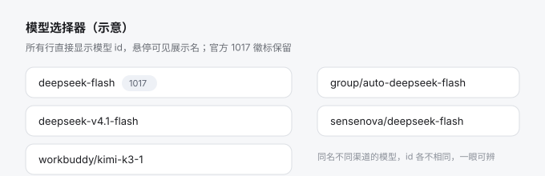

# dsh-model-vendor-label

让 DeepSeek Harness（DSH）Web 界面**显示模型 id**，而不是供应商自己起的展示名。



## 问题

DSH 的模型选择器由 `@deepseek-ai/dsh-client-ui-model-selection` 提供。它的触发器
（右下角那颗模型按钮）、菜单的当前值行以及菜单里的每一行，默认显示的兜底文本都是
`model.name` —— 而 `model.name` 是**供应商自己起的展示名**，不是唯一键。真正决定
请求走哪条线路的是 `provider/model` 这一对 id。

于是当你的 `cordis.patch.yml` 里接了多家自定义 API，并且它们都把同一个上游模型挂在
同一个展示名下（例如 `DeepSeek-V4.1-Flash`、`deepseek-v4.1-flash`），界面就会出现
若干个一字不差的选项：能选，但选完不知道刚才点的是哪一家。

## 它做了什么

本插件的目标是**凡是显示模型名的地方，一律显示模型 id**；原名不丢，鼠标悬停即可看到。

两层实现，互相兜底：

1. **模型选择器（主路径）**：DSH 的模型名是一个可被插件接管的**单占位槽**
   `conversation.input.model.label`（`kind: 'single'`）。本插件占领这个槽，把触发器、
   菜单当前值行、每一行的文案从**展示名**换成**模型 id**（如 `deepseek-v4.1-flash`）。
2. **客户端模型目录（覆盖其它位置）**：同样的名字也出现在详情面板等地方，那些位置直接
   读客户端模型目录里的 `name`。因此本插件还会把目录中每个模型条目的**展示名临时改写
   成 id**（原值记录在一个不可枚举的私有属性里），这样任何渲染 `model.name` 的地方
   都变成 id。

配套的两点：

- **卸载即还原**：条目是"上色"而不是"改写"，插件卸载时把原名逐个写回，目录对象上看不到
  任何残留属性。
- **选择行为不变**：提交的仍是该行自己的 `provider/model` 对，选择、历史记录、KV 缓存
  的行为都不受影响；hover 文案保留原名。

### 显示开关（设置 → 通用）

插件在 **设置 → 通用** 里增加一行开关：

> **模型选择器显示模型 id**  
> 开启时，模型选择器显示模型 id（悬停可看展示名）；关闭后恢复 DSH 默认的展示名显示。  
> `[ ●———]`

行为：

| 状态 | 表现 |
| --- | --- |
| 开（默认） | 选择器显示模型 id；目录里的 `name` 临时改为 id，详情面板等处也是 id |
| 关 | 立即撤销本插件的登记（内置 `1017` 标签插件自动接管回来），目录 `name` 全部还原成展示名；**无需重启** |

开关值持久化在 DSH 自己的设置文档里（Host 半身的 `Config.enabled`，默认 `true`），
重装插件后仍保留。读取通道是浏览器的 `ctx.configForms`；宿主若没有设置服务，
插件仍按"开"工作，只是不显示这一行。

### 优先级与降级

- 内置 `1017` 标签插件以 priority 0 占着 `conversation.input.model.label`。本插件以
  `priority: -16` 注册（更小者渲染；动态包通常由运行时分配更小的优先级，这里显式给出
  的是对"运行时尊重显式值"的兼容）。
- 如果注册仍然失败（例如 DSH 改了遮蔽规则），只在控制台留一条警告并退回内置渲染，
  **不阻断页面**。

### 渲染形态

| 情况 | 输出 |
| --- | --- |
| 普通模型 | `模型id`（悬停显示原名） |
| 条目没有 id | 退回展示名，不报错 |
| 选择器触发器 / 菜单行 / 当前值行 | 同上，全部是 id |

带 `data-model-id="<id>"` 便于冒烟断言：`document.querySelectorAll('[data-model-id]').length > 0`。

## 安装

推荐从本仓库的 **Releases** 下载离线包（`v*` tag 由 CI 自动构建并附加校验和），
解压后直接指向目录安装：

1. 在 Releases 下载 `dsh-model-vendor-label-<版本>.zip`（或 `.tar.gz` / `.tgz`）。
2. 解压得到一个名为 `dsh-model-vendor-label-<版本>` 的目录。
3. 执行：

```bash
# macOS / Linux —— 路径必须写绝对路径
dsh plugin --profile web add "$HOME/Downloads/dsh-model-vendor-label-0.3.0"

# Windows（PowerShell）
dsh plugin --profile web add "$env:USERPROFILE\Downloads\dsh-model-vendor-label-0.3.0"
```

也可以直接装 tarball：`dsh plugin --profile web add /绝对路径/dsh-model-vendor-label-0.3.0.tgz`。

装完**重启 web profile 进程并刷新页面**。校验完整性（可选）：

```bash
shasum -a 256 -c SHA256SUMS.txt      # macOS
sha256sum -c SHA256SUMS.txt          # Linux
```

> 不通过 npm 安装：npm 上没有本仓库发布的包，同名包一律以本仓库 Releases 为准。

开发时直接指向源码目录也行（pnpm 会物化为 `link:`，改完刷新即生效）：

```bash
dsh plugin --profile web add /绝对路径/dsh-model-vendor-label
```

本插件是**纯浏览器半身**的包（Host 半身是空的 `apply()`，只为让 profile 行能挂载
浏览器半身），所以离线安装只需要这几个文件，不拉任何依赖。

`dsh plugin` 会在 profile 目录里转发 pnpm 装入依赖，并自动对账 `dsh.profile.bundles`：
凡是解析到声明了 `dsh.bundle.patch` 的包（本插件声明了 `./cordis.patch.yml`），名字会被
自动追加进层列表，bundle 自带的 insert 行随之生效——**不需要也不应该**再手动往
`~/.dsh/profiles/web/cordis.patch.yml` 里写 insert 行，否则 `model-vendor-label` 这个
loader id 会注册两遍而报错。

说明：

- 目录依赖会被 pnpm 物化为 `link:` 形式，改本仓库代码后重启/刷新页面即生效。
- 浏览器半身靠 `package.json` 里的 `dsh.client` 声明挂载，并且**绑定在 name 为裸包名
  的那一行**（`name: 'dsh-model-vendor-label'`）。写成子路径行不会带上浏览器半身。
- `package.json` 声明了 `engines.dsh` 与 `dsh.manifestVersion`，升级 DSH 后不兼容时
  便于排查。

## 回滚

```bash
dsh plugin --profile web remove dsh-model-vendor-label
```

依赖移除时 `dsh plugin` 会同步把包从 `dsh.profile.bundles` 层列表里清掉；重启进程后
内置的 `1017` 标签插件重新接管槽位，目录里的名字也会在卸载时还原，界面恢复原状。

## 验证

```bash
cd dsh-model-vendor-label
node --test 'test/*.test.mjs'

# 装好后核对行已挂上（应恰好输出一个 id: model-vendor-label 段）
dsh --profile web --dump-config | grep -A3 model-vendor-label
```

测试用 `vm` 模拟浏览器里的 `window.__ModuleLoader__` 和最小 React，直接跑真实的
`client.js`（15 条，全绿），覆盖：id 渲染与悬停原名、目录上色与还原、优先级与注册失败
时的警告降级、composer 座位接管、以及 package.json 契约自检。装好后打开模型菜单，行
文案应为模型 id；控制台冒烟：`document.querySelectorAll('[data-model-id]').length` 大于 0。

## 升级 DSH 时要注意什么

插件装在 `~/.dsh/profiles/<profile>` 里，和全局的 `@deepseek-ai/dsh` **互不影响**：
`npm i -g @deepseek-ai/dsh` 不会动你的插件目录。但有四处会咬人：

| 风险 | 表现 | 处理 |
| --- | --- | --- |
| `engines.dsh` 不匹配 | 升级后插件被跳过，界面恢复默认 | 装支持新版本的插件版；或临时用 `dsh plugin --profile <p> allow-version <包>@<版本> --dsh-version <精确版本> --accept-risk` 放行 |
| 内部契约漂移 | 槽位/设置服务改名后插件静默失效 | 看控制台有没有 `model-vendor-label` 的 warn；提 issue |
| `link:` 依赖断链 | 启动报 `cannot resolve profile bundle` | 别移动/删除被 link 的插件目录，或用 `.tgz` 安装 |
| pnpm 虚拟store 变更 | `ERR_PNPM_VIRTUAL_STORE_DIR_MAX_LENGTH_DIFF` | 删掉 profile 的 `node_modules` 与 `pnpm-lock.yaml` 后重新 `dsh plugin add` |

升级后的三条自检：

```bash
dsh --profile web --dump-config | grep -A3 model-vendor-label   # 插件行还在？
dsh plugin --profile web ls                                      # 依赖还在？
# 打开页面：设置 → 通用里能看到"模型选择器显示模型 id"，模型菜单显示 id
```

## 打包与发布（维护者）

```bash
npm run pack:release     # → dist/：*.tgz、*.zip、*.tar.gz、SHA256SUMS.txt
npm test                 # 15 条无浏览器单测
```

发布走 GitHub Release：打一个与 `package.json` 版本一致的 tag 并推送即可，
`.github/workflows/release.yml` 会跑测试、构建三个产物并附加到 Release 上。

```bash
git tag v0.3.0 && git push origin v0.3.0
```

产物说明：

| 文件 | 用途 |
| --- | --- |
| `dsh-model-vendor-label-<版本>.zip` / `.tar.gz` | 离线安装：解压后 `dsh plugin add <解压目录>` |
| `dsh-model-vendor-label-<版本>.tgz` | 离线安装：`dsh plugin add <file>.tgz`，或放进 profile 的 `vendor/` |
| `SHA256SUMS.txt` | 三个产物的校验和 |

### 离线安装的原理与注意

- `dsh plugin add <目录>` 会让 pnpm 记录一条 `link:` 依赖，**目录不要删**；
  想彻底摆脱目录可以改用 `.tgz`（pnpm 会把内容装进 profile 的 `node_modules`）。
- 被安装的包只要声明了 `dsh.bundle.patch`，`dsh` 就会把它自动加进
  `dsh.profile.bundles`，**不要再手写 `cordis.patch.yml` 的 insert 行**。
- 桌面版（Electron）的 `desktop` profile 由应用独占管理，命令行安装会被拒绝；
  请在应用的「设置 → 插件」里安装，或改用 `web` profile。
- 若宿主有 profile 闸门（部分整合包会拒绝 `link:`/junction），改用 tarball 形式安装。

## 不做的事 / 已知限制

- **不改变选择**：只改变显示文本。
- **同一 provider 下相同 id 的模型仍无法区分**（如 `workbuddy/deepseek-v4.1-flash`
  与 `workbuddy-ai/deepseek-v4.1-flash`，id 相同）；想要更细的区分可在 profile 里
  给它们起不同的展示名。
- **不持久化任何配置**：没有设置项。
- **目录上色是"修补"式的**：它依赖客户端模型目录的 `groups[].models[]` 形状；DSH 若
  重构该目录，插件会退回到仅接管选择器 label 槽（选择器仍然显示 id），并在控制台告警。
- **只能有一个占用者**：本插件接管 `conversation.input.model.label` 后，其他想占同一
  个槽的插件（包括内置的 `1017` 标签插件）就不再生效。

## 更轻的替代方案（不改代码）

如果你只是想让名字不撞，直接在 profile 里给每个模型写带供应商的 `name` 即可：

```yaml
- id: llm-pi-ai
  name: "@deepseek-ai/dsh-llm-pi-ai"
  config:
    providers:
      buddy:
        displayName: Buddy
        models:
          - id: deepseek-v4.1-flash
            name: deepseek-v4.1-flash (Buddy)   # ← 撞名就靠这个后缀区分
```

缺点是每加一家供应商都要手工维护一遍；本插件在运行时统一显示 id，零维护。

## 文件

| 文件 | 作用 |
| --- | --- |
| `index.js` | Host 半身：空 `apply()`，让 profile 行有个真实模块可加载 |
| `client.js` | 浏览器半身：手写 `window.__ModuleLoader__` bundle，接管 label 槽 + 目录上色 + composer 座位 |
| `cordis.patch.yml` | bundle patch：一行 insert 挂载本包 |
| `test/label.test.mjs` | 无浏览器单测（`node --test`） |
